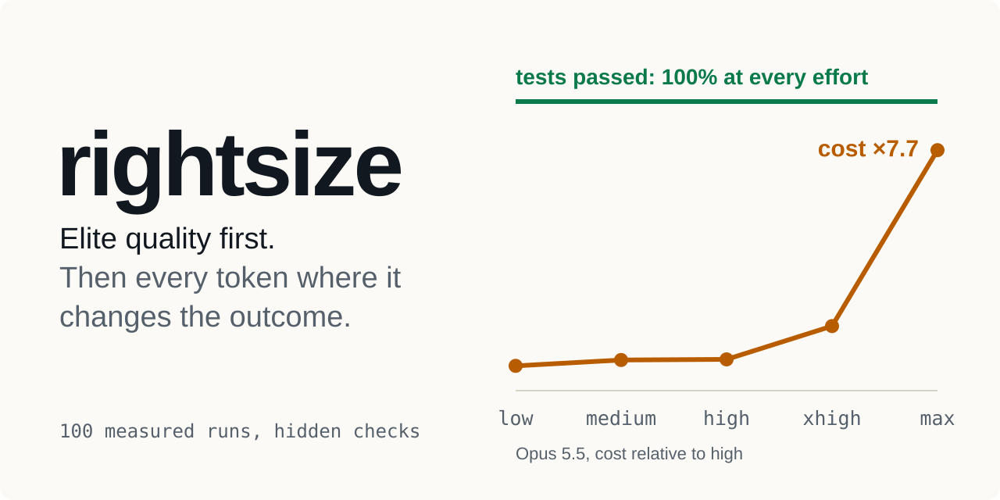
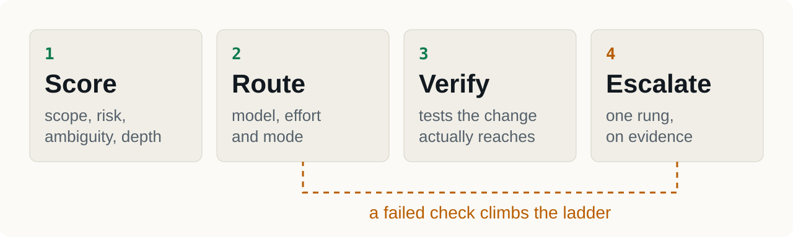
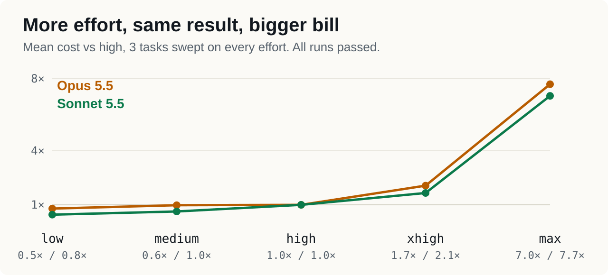
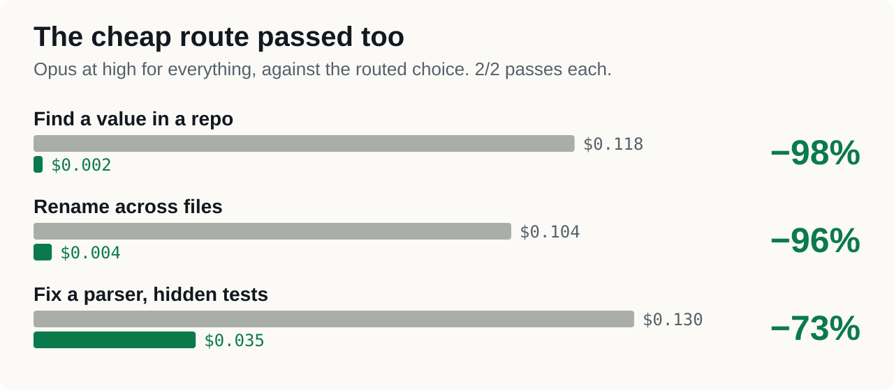

<picture>
  <source media="(prefers-color-scheme: dark)" srcset="docs/assets/cover-dark.svg">
  
</picture>

<p align="center">
  <a href="https://github.com/spar-x-fr/spar-x-skills/actions/workflows/ci.yml"></a>
  
  
</p>

<p align="center">
  <a href="docs/getting-started.md"><b>Get started</b></a> ·
  <a href="#measured-not-claimed"><b>Measurements</b></a> ·
  <a href="docs/usage-guide.md"><b>Usage guide</b></a> ·
  <a href="docs/faq.md"><b>FAQ</b></a>
</p>

> This folder holds the full rightsize project by Ayoub Hammoudi
> project (commit `c3b63f4`) with the skill files at its root. In these guides,
> `<rightsize>` is this folder. The plugin of the original project keeps its scripts in
> `skills/rightsize/scripts/`. CI, repository settings and the plugin manifest live at the root of
> [spar-x-fr/spar-x-skills](https://github.com/spar-x-fr/spar-x-skills); see its `docs/maintainers.md`.

A Claude Code plugin that gives every session an expert work strategy: the right
playbook for the job, the right model (Haiku 5.5, Sonnet 5.5, Opus 5.5, Fable 5.1),
the right effort (`low` to `max`), the right mode (inline, sub-agent, plan, separate
session), and verification proportionate to the change. It escalates on evidence,
never on habit.

```text
/plugin marketplace add spar-x-fr/spar-x-skills
/plugin install spar-x-skills@spar-x-skills
```

## How it works

<picture>
  <source media="(prefers-color-scheme: dark)" srcset="docs/assets/how-it-works-dark.svg">
  
</picture>

## Rule 0: quality before optimisation

The deliverable must reach the standard of the best expert in the field. Savings
never come from weaker reasoning on it; they come from everything around it:
lookups on cheap models, tests scoped to the change, no useless parallelism, a
stable prompt cache. When two tiers both look possible for the deliverable,
rightsize takes the stronger one.

## Measured, not claimed

**Effort sweep: 100 valid headless runs** (October 2026, Claude Code 2.1.308), 3 per
cell, on four tasks graded by hidden tests or an oracle, up to a regex engine
compared with Python's `re` on 3 000 random patterns.

<picture>
  <source media="(prefers-color-scheme: dark)" srcset="docs/assets/effort-cost-dark.svg">
  
</picture>

- **Every valid run passed from `low` up**, on Haiku, Sonnet and Opus 5.5. Haiku at
  `low` built a regex engine matching `re` on all 3 000 cases, 3 times out of 3, for $0.02.
- Above `medium`, effort bought nothing measurable on these tasks:

| Cost vs `high`, same model | low | medium | xhigh | max |
|---|---|---|---|---|
| Sonnet 5.5 | 0.4–0.6× | 0.5–0.8× | 1.4–1.9× | 5.0–8.1× |
| Opus 5.5 | 0.6–1.1× | 0.9–1.0× | 1.5–2.2× | 3.7–9.3× (4–7× slower) |

So rightsize lets a **check** (tests, an oracle, a compiler) carry the quality: a
verified task starts one effort level lower and climbs on failure. Work no check can
grade (design, review, open-ended tasks) keeps a high effort.

**Routing benchmark: 19 runs.** Against Opus at `high` for everything:

<picture>
  <source media="(prefers-color-scheme: dark)" srcset="docs/assets/routing-savings-dark.svg">
  
</picture>

| Task | Baseline | rightsize | Cost | Pass |
|---|---|---|---|---|
| Find a value in a repo, with decoys | $0.118 | haiku/low $0.002 | −98% | 2/2 vs 2/2 |
| Rename across files, add type hints | $0.104 | haiku/low $0.004 | −96% | 2/2 vs 2/2 |
| Fix a parser against hidden tests | $0.130 | sonnet/medium $0.035 | −73% | 2/2 vs 2/2 |

**Scoped testing:** 11.4 s full suite against 0.7 s scoped after a one-module change.

What the numbers do not say: these tasks are well specified and verifiable, where
low effort is safest; nothing here measures open-ended work. Samples are small.
Everything is reproducible with [`bench/`](docs/measuring.md).

## What is inside

| | |
|---|---|
| [`SKILL.md`](SKILL.md) | The strategy: rule 0, task scoring, routing table, modes, agent protocol, scoped verification, escalation, cache rules |
| [`PLAYBOOKS.md`](PLAYBOOKS.md) | Expert sequences: bug, feature, refactor, research, review, migration, performance, docs, sprint close |
| [`test_scope.py`](docs/scoped-testing.md) | Runs only the tests a change reaches; the full suite when that is the only safe answer; a ledger of full runs |
| [`token_audit.py`](docs/measuring.md) | Where your tokens and dollars go, from local transcripts |
| [`agent_audit.py`](docs/agents-and-protocol.md) | Finds agents without `model` / `effort` and proposes values |
| [`agents/`](docs/agents-and-protocol.md) | `rs-scout` (haiku/low), `rs-verifier` (haiku/low), `rs-builder` (sonnet/medium), `rs-sage` (opus/high) |
| [`hooks/`](docs/architecture.md) | Rules in every session (~200 tokens, once) and in every sub-agent brief (~130 tokens) |

## Guides

- [Getting started](docs/getting-started.md): install, check, uninstall
- [Usage guide](docs/usage-guide.md): what happens on its own, how to steer it, the effort button
- [Effort and models](docs/effort-and-models.md): what to use when, with the measurements
- [Scoped testing](docs/scoped-testing.md)
- [Agents and protocol](docs/agents-and-protocol.md)
- [Measuring](docs/measuring.md): your own usage, and the benchmark
- [Architecture](docs/architecture.md): layout and design decisions
- [FAQ](docs/faq.md)
- [Maintainer notes](docs/maintainers.md): repository security settings, going public, releasing

## Why not a prompt classifier in a hook

No Claude Code hook can change the main session's model or effort, so a classifier
in a prompt hook can only print advice, paid for on every prompt. rightsize acts
where Claude Code really lets you act: the Agent call, agent files, plan mode, and
the work strategy itself.

## Requirements

Claude Code 2.1.275 or later, Python 3.9+, git. No runtime dependencies.

## Contributing and security

See [CONTRIBUTING.md](CONTRIBUTING.md) and [SECURITY.md](SECURITY.md). Changes to the
routing rules need measurements.

## License

[MIT](LICENSE)
